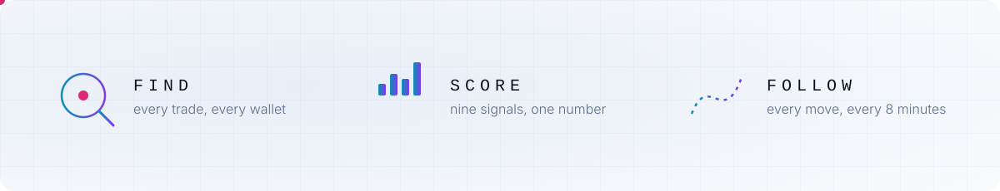

  <picture>
    <source media="(prefers-color-scheme: dark)" srcset="assets/readme/hero-dark.svg">
    
  </picture>

  <a href="https://danielseisenbacher.github.io/predictable/">
    <picture>
      <source media="(prefers-color-scheme: dark)" srcset="assets/readme/button-dark.svg">
      
    </picture>
  </a>

 

  <picture>
    <source media="(prefers-color-scheme: dark)" srcset="assets/readme/tell-dark.svg">
    
  </picture>

  <picture>
    <source media="(prefers-color-scheme: dark)" srcset="assets/readme/trio-dark.svg">
    
  </picture>

  <a href="https://danielseisenbacher.github.io/predictable/"><b>Dashboard</b></a>
  &nbsp;&nbsp;·&nbsp;&nbsp;
  <a href="https://github.com/danielseisenbacher/predictable/releases/latest/download/predictable.apk"><b>Android app</b></a>
  &nbsp;&nbsp;·&nbsp;&nbsp;
  <a href="https://github.com/danielseisenbacher/predictable/issues?q=label%3Ainsider-candidate"><b>Live alerts</b></a>

Heuristic leads, not proof. Most unusual bets have innocent explanations.

